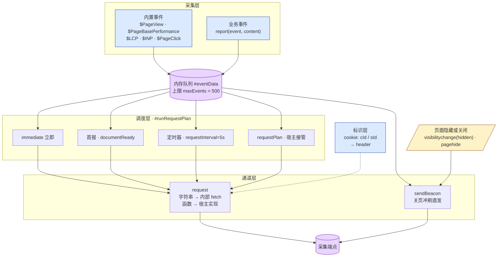
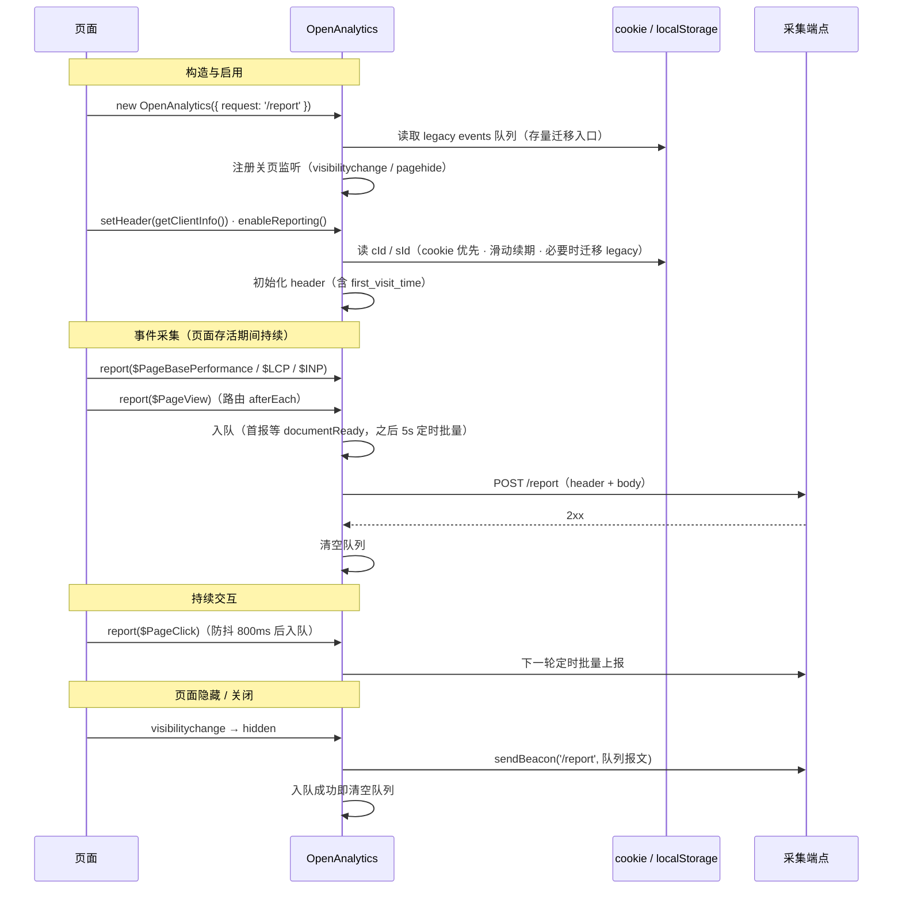
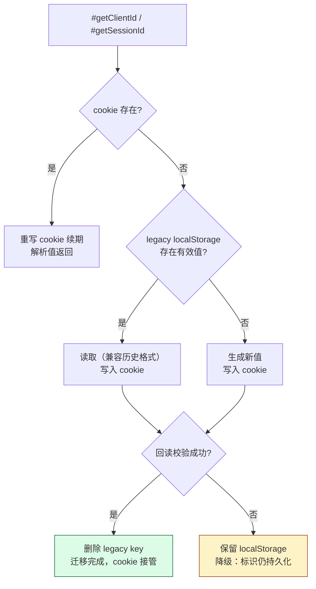
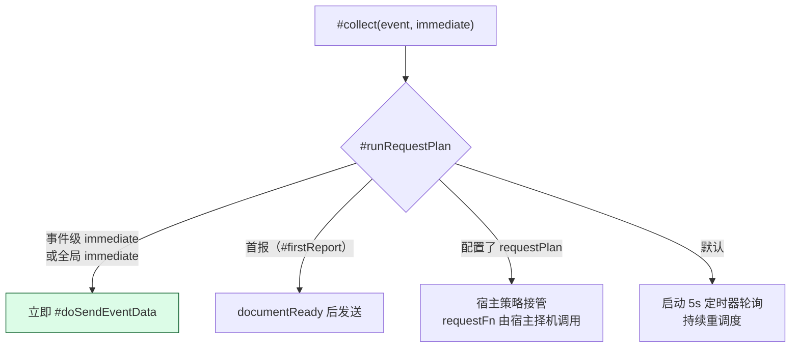

# open-analytics 设计文档

本文档说明 open-analytics 的整体架构、标识体系、事件与队列模型、上报通道与关页冲刷机制、存储布局与版本迁移策略。

> 对应版本：1.1.0（未发布）。快速接入 → [README](../README.md)。版本记录 → [CHANGELOG](../CHANGELOG.md)。本文面向维护者与需要理解内部行为的接入方。

## 目录

- [架构总览](#架构总览)
  - [整体架构](#整体架构)
  - [模块结构](#模块结构)
  - [一次完整访问的时序](#一次完整访问的时序)
- [数据模型](#数据模型)
  - [标识体系](#标识体系)
  - [事件模型](#事件模型)
  - [报文结构](#报文结构)
- [数据链路](#数据链路)
  - [队列与调度](#队列与调度)
  - [上报通道](#上报通道)
  - [关页冲刷](#关页冲刷)
  - [多标签页与多实例](#多标签页与多实例)
- [实现细节](#实现细节)
  - [存储布局](#存储布局)
  - [迁移与兼容](#迁移与兼容)
  - [构建与发布](#构建与发布)
  - [性能](#性能)
  - [SSR 与容错](#ssr-与容错)
  - [内部常量](#内部常量)
  - [本地调试](#本地调试)
  - [已知限制](#已知限制)
  - [规划](#规划)

# 架构总览

## 整体架构

采集层、内存队列、调度层、双通道四段串联，标识层独立于事件流。

- **采集层**：内置事件（web-vitals 性能、PV、点击）与业务自定义事件统一走 `report()` 入口；
- **队列层**：单实例内存队列，无持久化，多标签页互不影响；
- **调度层**：immediate 立即 / 首报等 documentReady / 定时器轮询 / requestPlan 完全接管，四档策略；
- **通道层**：常规批量走 `request`（字符串地址或宿主函数），关页冲刷走 `sendBeacon`，两条通道使用同一份报文结构；
- **标识层**：cId / sId 存于 first-party cookie，生成 header 通用字段，与事件流解耦。



**关键点**：

- 队列不持久化。多标签页共享同一 localStorage key 且写入为全量覆盖，后写者会覆盖其他标签页未上报的事件，补报的前提在多标签页场景下并不成立；关页场景由 sendBeacon 处理。
- 标识与事件流解耦：标识进 header（每批一份），事件进 body（每条携带 sId），服务端无需会话状态。
- 两条通道的报文结构、序列化方式完全一致，服务端只有一套解析逻辑。

## 模块结构

```text
packages/analytics/
├── src/
│   ├── open-analytics.ts     核心类：标识管理、队列、调度、上报
│   ├── events/               内置事件采集器，构建期自动注册
│   │   ├── index.ts          import.meta.glob 收集注册
│   │   ├── _keys.ts          OpenEventKeys 事件名常量
│   │   ├── pv.ts             $PageView
│   │   ├── performance.ts    $PageBasePerformance
│   │   ├── lcp.ts / inp.ts   $LCP / $INP
│   │   └── page-click.ts     $PageClick
│   ├── plugins/client.ts     getClientInfo()：UA → os/browser/device
│   ├── cookie.ts             cookie 读写，属性封装
│   ├── storage.ts            localStorage 封装（过期管理），迁移与降级用
│   ├── constant.ts           TTL / 间隔 / 上限常量
│   ├── types.ts              对外类型
│   └── utils.ts              工具函数
├── test/                     SDK 调试页（pnpm dev，3300 端口）
└── dist/                     构建产物（单文件 ES 模块 + 类型）
```

### 核心文件

| 文件 | 职责 |
| --- | --- |
| `open-analytics.ts` | `OpenAnalytics` 类。构造归一化 request、注册关页监听；`#getClientId` / `#getSessionId` 标识获取；`#collect` / `#runRequestPlan` / `#doSendEventData` 队列与调度；`#doPageEndFlush` 关页冲刷 |
| `events/index.ts` | 内置事件注册表。`import.meta.glob(['./*.ts', '!./_keys.ts', '!./index.ts'])` 构建期收集，模块导出 `{ event, collector }` 即完成注册，`isInnerEvent` / `reportInnerEvent` 提供查询与派发 |
| `cookie.ts` | `setCookie`（Path=/ · SameSite=Lax · https 自动 Secure · 可选 Domain · Max-Age 毫秒转秒）、`getCookie`、`removeCookie`，非浏览器环境全部 no-op |
| `storage.ts` | envelope `{ expire, value, once }` 封装，`get` / `getAlways` 支持过期检查、滑动续期回调；当前仅服务标识迁移与降级 |
| `plugins/client.ts` | UAParser 解析 userAgent，输出 `os / os_version / browser / browser_version / device / device_type / device_vendor`，由宿主 `setHeader` 注入 |

### 内置事件注册机制

目录约定优于显式注册：`events/` 下新增一个符合 `{ event, collector }` 导出契约的模块即自动生效。事件名与属性字段统一 `$` 前缀，与业务事件隔离；排除规则中 `_keys.ts`（常量）与 `index.ts`（注册表自身）不参与采集。

## 一次完整访问的时序

以字符串地址接入、SPA 路由上报 PV 的典型用法为例，一个页面生命周期内各环节的先后关系：



三个实现细节：

1. **构造即注册关页监听**，不等 `enableReporting`——`enabled` 守卫在冲刷时判断，避免启用前误发；
2. **首报由第一个事件驱动**（`#firstReport` 标记），等待 documentReady 后发送，避免阻塞页面加载；
3. **sId 滑动续期发生在每次事件采集时**（`report` → `#getSessionId` 重写 cookie），活跃用户的会话不会因 30 分钟 Max-Age 自然过期而中断。

# 数据模型

## 标识体系

### cId（客户端标识）

- 存储：cookie `oa-{appKey}-cId`，Max-Age 180 天（滑动续期），Path=/，SameSite=Lax，https 环境附加 Secure；`cookieDomain` 可配置 Domain 实现跨子域共享；
- 值格式：`{uuid}.{created_at}`，created_at 为首次访问毫秒时间戳，与 GA `_ga` 的值格式一致；
- 上报路径：解析后以 `cId`（uuid 部分）与 `first_visit_time`（created_at）进入 header，服务端无需自身状态即可计算新老访客。

### sId（会话标识）

- 存储：cookie `oa-{appKey}-sId`，Max-Age 30 分钟（滑动续期：每次读取重写）；
- 值即会话开始毫秒时间戳，与 GA4 `ga_session_id` 的含义一致；
- 每条事件携带 sId，`event.time - sId` 即事件发生在会话内的毫秒数，会话深度分析不依赖服务端；
- 会话跨标签页共享（同 origin），任一标签页活跃即续期，与 GA、Matomo 的 cookie 会话行为一致。

采用时间戳而非随机串作为 ID 的理由：ID 自身携带会话起点，任意一条事件即可独立计算会话深度；时间戳本身有序，服务端可直接按时间范围检索会话；13 位数字窄于 36 位 uuid，每条事件都携带 sId，报文整体更小。代价是跨用户存在同毫秒碰撞的可能，会话聚合应使用 `(cId, sId)` 组合键——匿名标识本就不应单独充当全局主键。

### 标识获取流程

`#getClientId` 与 `#getSessionId` 逻辑一致，都是"cookie 优先 → legacy 迁移 → 新建"三段式：



两处差异：cId 的 legacy 值为 `{ id, created_at }` 对象（缺失 created_at 补当前时间）；sId 的 legacy 值为数字时间戳时迁移、uuid 对象（0.0.6 ~ 1.0.2 版本格式）视为过期重新生成。

降级分支保证浏览器禁用 cookie 时标识仍在 localStorage 持久化，避免每次页面加载重新生成 cId 导致 UV 虚增；代价是每次加载多一次 cookie 写入与回读。

### 存储介质选择

cookie 而非 localStorage：同域请求自动携带（服务端可直接读取）、浏览器自带的过期管理、跨子域能力。合规层面，ePrivacy 对设备存储的要求不区分 cookie 与 localStorage，采用 cookie 使存储行为可被常规同意管理工具识别和管控。

## 事件模型

```ts
interface EventData {
  event: string;       // 事件名，内置事件带 $ 前缀
  time: number;        // 采集时间（毫秒时间戳）
  properties: object;  // 事件数据，内置事件字段带 $ 前缀
  sId: number;         // 会话开始时间戳，0 表示尚未关联会话
}
```

`report(event, content?, options?)` 的分派逻辑：

| 事件类型 | 行为 |
| --- | --- |
| 内置事件（`isInnerEvent` 命中） | `content` 函数在采集器触发时执行，返回值与采集器数据合并后入队；`options.eventOptions` 透传给采集器（如 `$PageClick` 的防抖 delay） |
| 业务事件 | `content` 函数立即执行，返回值作为 properties 入队 |
| `options.immediate` | 跳过批量等待，该事件单独立即上报 |

内置事件名与 `OpenEventKeys` 常量对应（`_keys.ts` 中定义）：

| `OpenEventKeys` 常量 | 事件名 |
| --- | --- |
| `OpenEventKeys.PV` | `$PageView` |
| `OpenEventKeys.PageBasePerformance` | `$PageBasePerformance` |
| `OpenEventKeys.LCP` | `$LCP` |
| `OpenEventKeys.INP` | `$INP` |
| `OpenEventKeys.PageClick` | `$PageClick` |

内置事件属性明细：

| 事件 | 属性 |
| --- | --- |
| `$PageView` | `$url` `$path` `$hash` `$search` `$title` `$referrer` |
| `$PageBasePerformance` | `$url` `$fcp` `$ttfb` `$load` `$navigationEntry` `$connection`（downlink / effectiveType / rtt / type，不可用时为 unknown） |
| `$LCP` | `$url` `$lcp` |
| `$INP` | `$url` `$inp` |
| `$PageClick` | `$url` `$pageX` `$pageY` `$documentScrollLeft` `$documentScrollTop`（capture 阶段监听，默认 800ms 防抖） |

## 报文结构

```json
{
  "header": {
    "env": "production",
    "uId": "",
    "cId": "9b2f6c1e-4f0a-4d3e-8f2a-1c2d3e4f5a6b",
    "first_visit_time": 1759337364123,
    "aId": "your-app",
    "oa_version": "1.1.0",
    "viewport_width": 1920,
    "viewport_height": 1080,
    "screen_width": 1920,
    "screen_height": 1080,
    "os": "Mac OS",
    "os_version": "14.5",
    "browser": "Chrome",
    "browser_version": "126.0.0.0",
    "device": "",
    "device_type": "",
    "device_vendor": ""
  },
  "body": [
    {
      "sId": 1759337364123,
      "event": "$PageView",
      "time": 1759337364123,
      "properties": {
        "$url": "https://example.com/page",
        "$path": "/page",
        "$hash": "",
        "$search": "",
        "$title": "Page",
        "$referrer": ""
      }
    }
  ]
}
```

header 字段说明：

| 字段 | 来源 | 说明 |
| --- | --- | --- |
| `env` / `uId` | 构造参数 / `setUserId` | 运行环境、登录用户 |
| `cId` / `first_visit_time` | cId cookie | 客户端标识、首次访问时间（新老访客判断） |
| `aId` | `appKey` | 应用标识 |
| `oa_version` | package.json | SDK 版本（以上为示例值，实际随 package.json） |
| `viewport_*` / `screen_*` | `#initHeader` | 视口与屏幕尺寸 |
| `os` / `browser` / `device*` | `setHeader(getClientInfo())` 注入 | 客户端信息，SDK 默认不采集 |

body 各字段见[事件模型](#事件模型)。

# 数据链路

## 队列与调度

### 队列规则

事件入队后若超过 `maxEvents`（默认 500）丢弃最早事件；队列仅在 `enabled` 时驱动上报。队列纯内存，页面关闭即释放。

### 调度规则



### 发送与清队规则

`#doSendEventData` 的成功判定直接决定队列生命周期：

| request 返回 | 行为 |
| --- | --- |
| `Promise`，resolve `true` | 清空队列，删除 legacy events key |
| `Promise`，resolve `false` / reject | 保留队列，下轮重试 |
| 非 Promise（含 undefined） | 同步清空队列（兼容 1.0.x 宿主契约） |

## 上报通道

### request 的两种形式

| 形式 | 行为 | 适用 |
| --- | --- | --- |
| 字符串 | `createRequestByUrl` 生成内部实现：fetch POST JSON（Content-Type: application/json），非 2xx 或网络错误返回 `false` 保留队列 | 默认推荐 |
| 函数 | 宿主自行实现 `(data) => Promise<boolean> \| void`，SDK 不感知 URL 与传输细节 | 鉴权 header、多环境端点、自定义协议 |

支持字符串形式的原因：关页冲刷需要 SDK 掌握上报地址（sendBeacon 直发），而函数形式下地址封闭在宿主闭包内、SDK 无法获取。字符串形式让最常见的接入（自有端点、无传输定制）一行配置即可同时获得批量上报与关页冲刷，函数形式保留给需要自定义传输的场景。构造时两者归一化为统一的 `ReportRequest`，后续链路无差别。

### 环境切换

`setEnvironment` 在环境变化时先以 immediate 策略冲刷当前存量数据，再切换 header.env，避免旧环境数据被记入新环境。

## 关页冲刷

目标地址按以下优先级确定（构造时写入 `#beaconUrl`）：

```text
配置了 beaconUrl        → sendBeacon(beaconUrl)
未配置，request 是字符串 → sendBeacon(request)     ← 默认路径
未配置，request 是函数   → 不执行关页冲刷
```

执行细节：

- 触发事件为 `visibilitychange`（hidden，移动端后台化时最可靠）与 `pagehide`，两者都监听；冲刷后清空队列，第二个事件触发时队列为空，直接返回；
- 报文与常规通道相同（`JSON.stringify({ header, body })`），以字符串发送（text/plain），跨域不触发预检；
- `sendBeacon` 返回 `true`（入队成功）才清空队列；返回 `false`（配额满）时保留队列，页面仍存活的场景（标签页切换）由定时上报重试。

### sendBeacon 约束

| 约束 | 影响 |
| --- | --- |
| 仅 POST、无自定义 header | 端点依赖鉴权头时需改同源 cookie 鉴权或独立无鉴权端点 |
| 单次 body 配额（通常 64KB） | 队列满载（500 条 ≈ 150KB）时可能被拒收，正常关页队列远小于此 |
| 无响应可读 | 发后不管，无送达确认 |

## 多标签页与多实例

并发场景下各对象的行为，多数由前面的架构选择直接决定，逐项列出以免产生疑问：

| 维度 | 行为 | 说明 |
| --- | --- | --- |
| 标识（cId / sId） | 跨标签页共享 | 同 origin 共享 cookie，任一标签页活跃即给 sId 续期，行为与 GA / Matomo 的 cookie 方案一致 |
| 事件队列 | 各标签页独立 | 内存队列互不可见，不存在旧 localStorage 方案中全量覆盖丢数据的问题 |
| 关页冲刷 | 各标签页独立触发 | 各自 sendBeacon 自己的队列，互不影响 |
| 迁移竞态 | 一次性重复上报 | 升级后两个标签页同时启动、都读到 legacy events 队列 → 各自上报一份。仅发生在迁移完成的首次访问，服务端如需严格去重可按 `(cId, sId, event, time)` 幂等 |
| 多实例（不同 appKey） | 完全隔离 | key、cookie、队列、上报通道按 appKey 独立，可同页共存 |
| 多实例（相同 appKey） | 共享标识、双份链路 | 标识一致，但队列与关页监听各自独立，会双份冲刷。应避免同 appKey 多实例 |

# 实现细节

## 存储布局

| key | 介质 | 值 | TTL | 状态 |
| --- | --- | --- | --- | --- |
| `oa-{appKey}-cId` | cookie | `{uuid}.{created_at_ms}` | 180 天滑动 | **主存储** |
| `oa-{appKey}-sId` | cookie | 会话开始毫秒时间戳 | 30 分钟滑动 | **主存储** |
| `oa-{appKey}-client` | localStorage | envelope `{ expire, value: { id, created_at } }` | 180 天 | legacy，迁移源 / 降级 |
| `oa-{appKey}-session` | localStorage | envelope，value 为数字或旧版 uuid 对象 | 30 分钟 | legacy，迁移源 / 降级 |
| `oa-{appKey}-events` | localStorage | envelope，value 为 `EventData[]` | — | legacy，构造时读入内存，首次成功上报后删除 |

cookie 属性：`Path=/; SameSite=Lax`，https 环境附加 `Secure`（本地 http 开发不受影响），`cookieDomain` 配置时附加 `Domain`。`appKey` 为空时 key 形如 `oa-cId` / `oa-sId`。

`enableReporting(false)` 清除以上全部 key 与 cookie。

## 迁移与兼容

| 存量数据 | 版本来源 | 迁移行为 |
| --- | --- | --- |
| cId：`{ id }`（无 created_at） | ≤ 1.0.2 | 保 uuid，created_at 补当前时间，写入 cookie 后删 legacy key |
| cId：`{ id, created_at }` | 1.1.0 内部迭代版本 | 原值迁移 |
| sId：数字时间戳 | 1.1.0 内部迭代版本 | 原值迁移 |
| sId：`{ id: uuid }` | 0.0.6 ~ 1.0.2 | 视为过期，重新生成时间戳会话 |
| events 队列：`EventData[]` | ≤ 1.0.2 | 构造时读入内存参与上报，首次成功上报后删 key |
| 无任何存量 | 新用户 | 直接走 cookie |

迁移期间报文中 cId / sId / first_visit_time 的值与迁移前一致，服务端无感。报文层面的不兼容变化仅一处：**sId 类型由字符串（uuid）变为数字**（1.1.0），服务端解析需同步。

## 构建与发布

### 构建

vite 库模式（`packages/analytics/vite.config.mts`）：

- 入口 `src/index.ts`，产物 `dist/open-analytics.mjs`，仅 ES 格式，target `chrome74`；
- 类型由 vite-plugin-dts 生成并 rollup 为单文件 `dist/open-analytics.d.ts`；
- 运行时依赖固定版本（uuid / web-vitals / ua-parser-js），版本由根 `pnpm-workspace.yaml` catalog 统一管理。

### 发布与 README 同步

npm 包页面只读包目录下的 README，而文档统一维护在仓库根目录，发布时由生命周期钩子自动复制（`packages/analytics/package.json`）：

```json
"prepack": "node -e \"require('node:fs').copyFileSync('../../README.md', 'README.md')\"",
"postpack": "node -e \"require('node:fs').rmSync('README.md', { force: true })\""
```

- `prepack` 在 tarball 打包前把根 README 复制进包目录——npm 无条件打包 README / LICENSE / package.json，不受 `files: ["dist"]` 限制；
- `postpack` 在 tarball 生成后立即删除，即使 publish 失败也不留脏文件；
- `node -e` 实现，macOS / Windows 行为一致（避开 `cp` / `rm` 等 unix 专属命令）；
- `.gitignore` 忽略 `packages/analytics/README.md` 与 `*.tgz`，防止同步产物误提交。

发布流程：`pnpm --filter @opensig/open-analytics build` → `pnpm release`（publish 至 npmjs.org）。

## 性能

| 指标 | 数值 | 说明 |
| --- | --- | --- |
| 构建产物 | ~57KB（gzip ~17KB） | 含三个运行时依赖 |
| 单事件序列化体积 | ~250B | PV / 点击类事件的典型值 |
| 队列内存上限 | 500 条 ≈ 150KB 序列化 | JS 对象形式约 2~4 倍，即最坏几百 KB 堆内存 |
| 事件入队 | O(1) | push + 上限淘汰 shift |
| sId 续期 | 每次事件采集一次 `document.cookie` 赋值 | 低于旧方案每次事件全量 JSON.stringify 队列并写 localStorage 的开销 |
| `$PageClick` 常驻开销 | 一个 capture 全局监听 + 800ms 防抖定时器 | 仅在 report 该事件后存在 |

## SSR 与容错

- 非浏览器环境（Node SSR）：`isClient` 判定，storage 降级为模块级内存对象，cookie 与事件监听 no-op，模块导入无副作用（0.0.5 起的约束）；
- localStorage 写入包裹 try/catch：配额溢出、隐私模式静默失败，不向宿主抛异常；
- cookie 写入后回读校验，失败即降级 localStorage 路径。

## 内部常量

| 常量 | 值 | 含义 |
| --- | --- | --- |
| `SESSION_EXPIRE_TIME` | 30 分钟 | sId 滑动有效期 |
| `CLIENT_EXPIRE_TIME` | 180 天 | cId 滑动有效期 |
| `DEFAULT_REQUEST_INTERVAL` | 5 秒 | 默认批量上报间隔 |
| `MAX_EVENTS` | 500 | 内存队列上限，序列化约 150KB |

## 本地调试

```bash
pnpm install
pnpm dev:demo    # 演示站点，3200 端口
pnpm dev         # SDK 调试页，3300 端口
```

演示站点的 dev server 内置模拟采集端点（`packages/demo/vite.config.ts` 的 mock-report 插件）：接收 `/report` POST 并将报文打印到终端，定时上报与关页 beacon 均可见。

验证要点：

- **标识**：DevTools → Application → Cookies，查看 `oa-test-cId` / `oa-test-sId`；刷新页面观察 Max-Age 被续期（滑动）；
- **常规上报**：Network 面板过滤 `/report`，5 秒一批；
- **关页冲刷**：Network 勾选 Preserve log 后关闭标签页，可见最后的 sendBeacon 请求（Initiator 为 beacon）；
- **降级路径**：DevTools → Application → Cookies → Block，刷新后标识回落到 localStorage；
- **存量迁移**：手动在 localStorage 写入旧格式 `oa-test-client` 后刷新，观察值迁入 cookie、旧 key 被删除。

## 已知限制

1. request 为函数且未配置 `beaconUrl` 时不存在关页冲刷，此类接入需补配；
2. 关页时网络不可用导致的数据丢失，客户端无法可靠补偿；
3. `#doSendEventData` 竞态：request 返回 Promise 的执行期间新采集的事件，会被成功回调中的队列清空一并丢弃（→ [上报竞态修复](#上报竞态修复)）；
4. `report` 对同一内置事件的多次调用会重复注册采集器（如 `$PageClick` 叠加 click 监听），每个内置事件生命周期内应只 report 一次（→ [采集器去重](#采集器去重)）；
5. `request` 回调同步抛出的异常会沿调用栈传播至业务代码（`#doSendEventData` 未包裹 try/catch），宿主回调应自行捕获（→ [上报异常容错](#上报异常容错)）；
6. Safari 对脚本可写存储实施 7 天无交互清除，cookie 与 localStorage 均受影响；服务端 Set-Cookie 下发的 cookie 不受限，当前未依赖该能力。

## 规划

| 方向 | 说明 |
| --- | --- |
| HTML script 引入 | 提供 UMD / IIFE 构建与 window 全局挂载，支持无构建环境接入 |
| session_count | 会话序号，对标 `ga_session_number`，补齐留存与频次分析维度 |
| consent 门控 | 授权前不读写任何设备存储，配合同意管理工作流 |
| 错误告警上报 | 单条事件的丢失代价高于埋点，引入关页快照与下次访问补报（at-least-once，接受重复） |
| 服务端下发 cId | 采集端点 Set-Cookie，获得 Safari 清除豁免与防篡改能力 |
| <a id="上报竞态修复"></a>上报竞态修复 | `#doSendEventData` 按已发送批次剔除，避免 in-flight 事件被误清 |
| <a id="采集器去重"></a>采集器去重 | 同一内置事件重复 report 时避免叠加监听 |
| <a id="上报异常容错"></a>上报异常容错 | request 回调异常不再传播至业务调用栈 |
